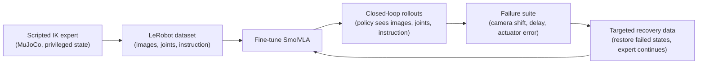

# humanoid-vla

Language-conditioned manipulation on a simulated Unitree G1 humanoid with a
vision-language-action (VLA) model. The project fine-tunes SmolVLA to sort
blocks into bins from instructions such as "Put the red block in the left
bin". It then measures where the policy breaks under camera, latency and
actuator errors, and tests whether targeted training data makes it more
robust.

**Status (2026-10-11):** planning. No environment, dataset, training run or
result exists yet. Work starts with Milestone 0: feasibility on a single 12 GB
GPU. This README describes the plan. Numbers, videos and claims will be added
only after they are measured.

## Pipeline

## Setup

| | |
|---|---|
| Robot | Unitree G1 from [MuJoCo Menagerie](https://github.com/google-deepmind/mujoco_menagerie/tree/main/unitree_g1) (`g1_with_hands`), fixed base, one 7-DOF arm, Dex3 three-finger hand |
| Task | Instruction-conditioned block sorting: several colored blocks, two bins |
| Observations | RGB camera image(s), arm joint positions, hand state, instruction text |
| Actions | 7 arm joint-position targets and 1 hand-closure value mapped to a finger-joint synergy |
| Policy | [SmolVLA](https://huggingface.co/docs/lerobot/smolvla) (450M) with [LeRobot](https://github.com/huggingface/lerobot) and PyTorch; default fine-tuning compared with LoRA |
| Simulator | MuJoCo with a Gymnasium-style wrapper |
| Compute | One RTX 4070 (12 GB) under WSL2 |

The scripted expert and the evaluator may read simulator object poses; the
learned policy never does. Grasps are physical contact. Objects are not welded
to the hand.

## Planned experiments

**Failure suite.** Three perturbations, each at two severities, plus the
clean condition. Every scenario is saved with its reset state, instruction,
disturbance schedule and seeds so it can be replayed.

| Perturbation | Implementation | What it probes |
|---|---|---|
| Camera mounting shift | Bounded translation and rotation of the rendered camera | Sensitivity to viewpoint mismatch |
| Observation delay | Timestamped frame queue with a declared delay | Stale visual input |
| Arm execution error | Actuator lag or gain change | Actual motion differing from commanded motion |

**Adaptation study.** Starting from the same nominal checkpoint, with matched
training-frame and optimizer-update budgets:

- **A:** more nominal demonstrations
- **B:** demonstrations under broad randomization
- **C:** targeted recovery data: failed development states are restored and
  the expert continues from them; only continuations that succeed are kept

Conditions are compared on a frozen test split of paired scenarios that is
never used for data collection or tuning. Results will be reported with
confidence intervals, including any loss of clean-task success and any
negative or mixed outcomes.

**Metrics:** success rate by severity, wrong-object rate, drops, timeouts,
completion time, inference latency, simulation throughput and peak VRAM.

## Roadmap

- [ ] **M0 Feasibility:** MuJoCo rendering under WSL2, G1 scene, one SmolVLA
  training step and inference call within 12 GB
- [ ] **M1 Scripted expert:** physical-contact pick and place with seeded
  resets and labeled outcomes
- [ ] **M2 Dataset:** LeRobot-format dataset with a documented action
  contract, scenario splits and a replay check
- [ ] **M3 First policy:** fine-tuned SmolVLA completing held-out layouts in
  closed loop
- [ ] **M4 Failure suite:** reproducible perturbed scenarios and failure
  categories
- [ ] **M5 Adaptation study:** conditions A, B and C on the frozen test split
- [ ] **M6 Release:** verified install, demo checkpoint, dataset and model on
  the Hugging Face Hub, report and video

Planned extensions:
- π0.5 fine-tuned on the same dataset and run through the same failure suite.
  This needs a larger GPU: openpi lists more than 22.5 GB for LoRA
  fine-tuning.
- ACT baseline, teleoperated corrections, bimanual tasks.

## Scope

This project does not claim a new model architecture or method, whole-body
control or locomotion (the base is fixed), reinforcement learning,
physical-robot deployment, or sim-to-real transfer.

## Related work

The targeted-data experiment is closest to
[Kintsugi-VLA](https://arxiv.org/abs/2609.31048) (Snegirev et al., 2026). That
work uses simulator state restoration to turn failed SmolVLA rollouts on a
simulated Franka arm into recovery data. This project applies a similar idea
to a humanoid with a dexterous hand, and to sensing and actuation errors.

## Built on

- [LeRobot](https://github.com/huggingface/lerobot): datasets, training, PEFT
- [SmolVLA](https://huggingface.co/lerobot/smolvla_base): pretrained VLA
- [MuJoCo](https://github.com/google-deepmind/mujoco) and
  [MuJoCo Menagerie](https://github.com/google-deepmind/mujoco_menagerie):
  physics and the G1 model (BSD-3-Clause)
- [openpi](https://github.com/Physical-Intelligence/openpi): π0.5 (planned
  extension)

## License

Not chosen yet. It will be selected after reviewing the terms of the upstream
code, models and assets.

---

Apurv Kushwaha · [apurvkushwaha.com](https://apurvkushwaha.com)
