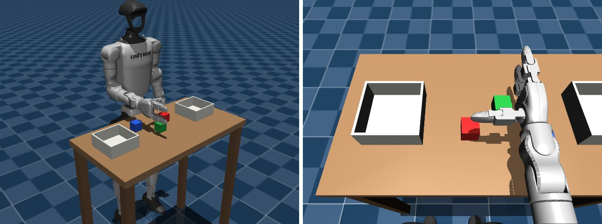
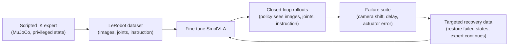

# humanoid-vla

Language-conditioned manipulation on a simulated Unitree G1 humanoid with a
vision-language-action (VLA) model. The project fine-tunes SmolVLA to sort
blocks into bins from instructions such as "Put the red block in the left
bin". It then measures where the policy breaks under camera, latency and
actuator errors, and tests whether targeted training data makes it more
robust.


*Milestone 0 scene: fixed-base G1 with the right arm and Dex3 hand active. Left: scene camera
for videos. Right: head camera, the candidate policy input. Layout and arm pose are tuned in
Milestone 1.*

**Status (2026-10-12):** Milestone 0 (feasibility) is complete. The scene, headless GPU
rendering and SmolVLA fine-tuning steps run locally on one RTX 4070 (12 GB); see the
[feasibility report](docs/reports/m0-feasibility.md). Next is Milestone 1, a scripted grasping
expert. There is no trained policy or task result yet. Numbers, videos and claims are added only
once measured.

## Quick start

Requires Linux x86_64 or WSL2, an NVIDIA GPU, and [uv](https://docs.astral.sh/uv/).

```bash
git clone https://github.com/ApurvK032/humanoid-vla.git && cd humanoid-vla
make setup          # Python 3.12 environment, git hooks, pinned G1 model
make test           # simulation and interface tests
make check-render   # rendering and physics throughput; images in outputs/
make check-smolvla  # SmolVLA memory, training-step time and inference latency
```

Setup details and troubleshooting are in the [runbook](docs/RUNBOOK.md).

## Pipeline



## Setup

| | |
|---|---|
| Robot | Unitree G1 from [MuJoCo Menagerie](https://github.com/google-deepmind/mujoco_menagerie/tree/main/unitree_g1) (`g1_with_hands`), fixed base; the right arm (7 joints) and its Dex3 three-finger hand (7 joints) are active, every other joint is frozen |
| Task | Instruction-conditioned block sorting: three colored blocks, two bins |
| Observations | Head-camera RGB (a wrist camera is under consideration), arm and hand joint positions, instruction text |
| Actions | 7 arm joint-position targets and 1 hand-closure value mapped to a finger-joint synergy |
| Policy | [SmolVLA](https://huggingface.co/docs/lerobot/smolvla) (450M) with [LeRobot](https://github.com/huggingface/lerobot) and PyTorch; default fine-tuning compared with LoRA |
| Simulator | MuJoCo 3.14 with a Gymnasium-style wrapper |
| Compute | One RTX 4070 (12 GB) under WSL2 |

The scripted expert and the evaluator may read simulator object poses; the
learned policy never does. Grasps are physical contact. Objects are not welded
to the hand.

## Milestone 0 measurements

On one RTX 4070 (12 GB) under WSL2, from [`results/m0/`](results/m0/):

- **Physics:** 87x real time for the tabletop scene.
- **Rendering:** about 30 fps per 256x256 camera image at full quality, or over 90 fps without
  shadows and reflections, headless through Mesa's D3D12 driver.
- **SmolVLA fine-tuning (LeRobot default, 100M of 450M parameters trained):** 5.6 GiB peak at
  batch size 32 and 9.8 GiB at 64, about 88 samples/s either way. Batch 128 exceeds the GPU.
- **Inference:** about 180 ms per 50-action chunk at batch size 1.

Details, including LoRA and VLM fine-tuning, are in the
[feasibility report](docs/reports/m0-feasibility.md).

## Planned experiments

**Failure suite.** Three perturbations, each at two severities, plus the
clean condition. Every scenario is saved with its reset state, instruction,
disturbance schedule and seeds so it can be replayed.

| Perturbation | Implementation | What it probes |
|---|---|---|
| Camera mounting shift | Bounded translation and rotation of the rendered camera | Sensitivity to viewpoint mismatch |
| Observation delay | Timestamped frame queue with a declared delay | Stale visual input |
| Arm execution error | Actuator lag or gain change | Actual motion differing from commanded motion |

**Adaptation study.** Starting from the same nominal checkpoint, with matched
training-frame and optimizer-update budgets:

- **A:** more nominal demonstrations
- **B:** demonstrations under broad randomization
- **C:** targeted recovery data: failed development states are restored and
  the expert continues from them; only continuations that succeed are kept

Conditions are compared on a frozen test split of paired scenarios that is
never used for data collection or tuning. Results will be reported with
confidence intervals, including any loss of clean-task success and any
negative or mixed outcomes.

**Metrics:** success rate by severity, wrong-object rate, drops, timeouts,
completion time, inference latency, simulation throughput and peak VRAM.

## Roadmap

- [x] **M0 Feasibility:** scene, headless GPU rendering, SmolVLA training step and inference
  within 12 GB
- [ ] **M1 Scripted expert:** physical-contact pick and place with seeded
  resets and labeled outcomes
- [ ] **M2 Dataset:** LeRobot-format dataset with a documented action
  contract, scenario splits and a replay check
- [ ] **M3 First policy:** fine-tuned SmolVLA completing held-out layouts in
  closed loop
- [ ] **M4 Failure suite:** reproducible perturbed scenarios and failure
  categories
- [ ] **M5 Adaptation study:** conditions A, B and C on the frozen test split
- [ ] **M6 Release:** verified install, demo checkpoint, dataset and model on
  the Hugging Face Hub, report and video

Task-level status is in [docs/ROADMAP.md](docs/ROADMAP.md). Planned extensions:

- π0.5 fine-tuned on the same dataset and run through the same failure suite.
  This needs a larger GPU: openpi lists more than 22.5 GB for LoRA
  fine-tuning.
- ACT baseline, teleoperated corrections, bimanual tasks.

## Repository layout

```text
src/humanoid_vla/   simulation (sim/), policy loading (policies/), provenance (utils/)
scripts/            entry points: asset fetch and checks
tests/              behavior and interface tests
docs/               plan, roadmap, decisions, runbook, reports
results/            committed measurements, each with git commit, versions and GPU
```

| Document | Contents |
|---|---|
| [CLAUDE.md](CLAUDE.md) | Contributor reference: layout, rules, environment gotchas |
| [docs/ROADMAP.md](docs/ROADMAP.md) | Milestone status and next tasks |
| [docs/DECISIONS.md](docs/DECISIONS.md) | Decision log and open questions |
| [docs/RUNBOOK.md](docs/RUNBOOK.md) | Setup, commands, troubleshooting |
| [docs/PROJECT_PLAN.md](docs/PROJECT_PLAN.md) | Original plan, scope and rationale |
| [docs/reports/](docs/reports/) | Milestone reports |
| [THIRD_PARTY.md](THIRD_PARTY.md) | Upstream code, models and assets, with pins and licenses |

## Scope

This project does not claim a new model architecture or method, whole-body
control or locomotion (the base is fixed), reinforcement learning,
physical-robot deployment, or sim-to-real transfer.

## Related work

The targeted-data experiment is closest to
[Kintsugi-VLA](https://arxiv.org/abs/2609.31048) (Snegirev et al., 2026). That
work uses simulator state restoration to turn failed SmolVLA rollouts on a
simulated Franka arm into recovery data. This project applies a similar idea
to a humanoid with a dexterous hand, and to sensing and actuation errors.

## Built on

[MuJoCo](https://github.com/google-deepmind/mujoco),
[MuJoCo Menagerie](https://github.com/google-deepmind/mujoco_menagerie) (G1 model),
[LeRobot](https://github.com/huggingface/lerobot),
[SmolVLA](https://huggingface.co/lerobot/smolvla_base) and
[PyTorch](https://pytorch.org). Versions, pins and licenses are in [THIRD_PARTY.md](THIRD_PARTY.md).

## License

Not chosen yet. It will be selected after reviewing the terms of the upstream
code, models and assets.

---

Apurv Kushwaha · [apurvkushwaha.com](https://apurvkushwaha.com)
