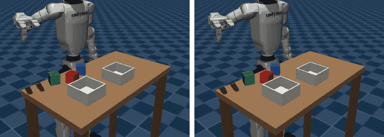
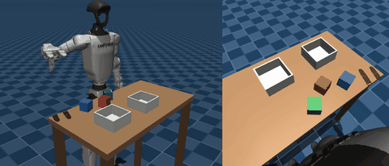
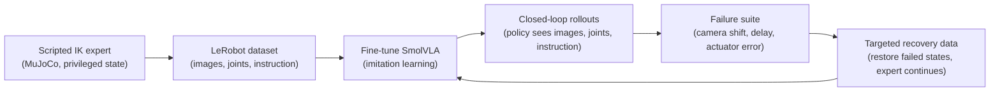

# humanoid-vla

**Language-conditioned manipulation on a simulated Unitree G1 humanoid with a fine-tuned
vision-language-action (VLA) model.**

[](https://github.com/ApurvK032/humanoid-vla/actions/workflows/ci.yml)



*The fine-tuned policy on a table it never trained on, given two instructions: "Put the green
block in the right bin" (left) and "Put the blue block in the left bin" (right). It sees only its
two cameras, its joint angles and the sentence.*

The robot's right arm and three-finger Dex3 hand sort colored blocks into bins from instructions
such as "Put the red block in the left bin." A scripted inverse-kinematics expert generates
demonstrations in MuJoCo; [SmolVLA](https://huggingface.co/lerobot/smolvla_base), a
450M-parameter VLA from Hugging Face, is fine-tuned on them by imitation learning with
[LeRobot](https://github.com/huggingface/lerobot) and PyTorch on a single NVIDIA RTX 4070 (CUDA),
then judged in closed loop on layouts it never saw. Next, the project measures how the policy
fails under camera, latency and actuator perturbations and tests whether targeted recovery data
makes it more robust.

## Highlights

- **73% closed-loop success on held-out layouts** (51 of 70 episodes, 95% interval 61-82%). The
  policy goes for the instructed block first in 80% of episodes and, on layouts given two
  different instructions, follows both 13 times out of 17.
- **A diagnosed language-grounding failure.** Three training runs whose loss kept falling
  learned to grasp and to follow the bin word ("left", "right") almost without fail, yet chose
  the block at chance. An open-loop instruction probe pinned it down, and a 2.5x longer
  schedule with float32 action-expert weights made the policy learn the color word.
- **A precision issue in the training stack.** LeRobot trains SmolVLA's action expert directly
  in bfloat16, without float32 master weights: in a pilot run only 24% of the expert's weights
  changed at all in the second half of training. The project adds float32 expert training and
  inference.
- **Physical-contact grasping.** The scripted expert sorts blocks in 499 of 500 held-out layouts
  with a palm-down "claw" pinch of the Dex3 hand: no welds, no hidden forces.
- **Reproducible by construction.** Pinned versions and Hub revisions, datasets whose every
  episode replays bit for bit, and a git commit, package versions and GPU recorded in every
  result file.

## Results

**First policy (M3).** Closed-loop evaluation on 50 held-out development layouts (70 episodes;
the policy observes every 0.4 s and predicts 2-second action chunks), from
[`results/m3/`](results/m3/):

| Run | What changed | Success (final checkpoint) | Instructed block first |
|---|---|---|---|
| `smolvla_v1` | LeRobot's default fine-tuning, 20,000 steps | 21/70 (30%) | 30% |
| `smolvla_v2` | every training layout under two instructions | 16/70 (23%) | 26% |
| `smolvla_v2_vlm` | v2, plus the VLM's text layers trained | 12/70 (17%) | 20% |
| `smolvla_v2_long_fp32` | v2, 50,000 steps, float32 expert weights | **51/70 (73%)** | **80%** |

The open-loop probe names each block in turn on the same layout and checks where the policy's
first action chunk sends the hand. The scripted expert sends it nearest the named block every
time; a policy that ignores the block word scores 33% by chance.

| Probe at checkpoint | 10k | 20k | 30k | 40k | 50k |
|---|---|---|---|---|---|
| The three 20,000-step runs | 33-37% | 37-42% | | | |
| `smolvla_v2_long_fp32` | 33% | 48% | 78% | 85% | 85% |

The full story, from the pilot to the bug hunt, is in the
[M3 report](docs/reports/m3-first-policy.md).


*The scripted expert behind the demonstrations, placing a block by physical contact: scene
camera (left) and the head camera the policy sees (right).*

**Scripted expert (M1).** 499 of 500 episodes succeed on held-out layouts (99.8%, 95% interval
98.9-100.0%); a typical episode takes 7.6 s. The expert reads block positions from the
simulator, which the learned policy never sees, and acts through the same 25 Hz interface the
policy uses ([M1 report](docs/reports/m1-scripted-expert.md)).

**Datasets (M2).** LeRobot-format datasets of about 300 training episodes (56,000 frames, two
256x256 cameras, AV1 video) with balanced instructions. Replaying every episode's recorded
actions reproduces its joint states exactly, which verifies that observations and actions are
aligned and mean what the [action contract](docs/ACTION_CONTRACT.md) says
([M2 report](docs/reports/m2-dataset.md)).

**Compute (M0).** On one RTX 4070 (12 GB) under WSL2: physics at 87x real time; about 30 fps per
256x256 camera image with shadows, headless on the GPU through EGL and Mesa's D3D12 driver;
SmolVLA fine-tuning at batch size 32 in 7.7-8.5 GB of VRAM at about 0.65 s per step; about
170 ms per 50-action chunk at inference ([M0 report](docs/reports/m0-feasibility.md)).

## How it works



1. **Simulation.** A fixed-base Unitree G1 from MuJoCo Menagerie, edited with MuJoCo's MjSpec
   API: the right arm (7 joints) and Dex3 hand (7 joints) are active, with actuator gravity
   compensation and elliptic friction cones for stable contact.
2. **Scripted expert.** Damped least-squares inverse kinematics with a null-space posture term
   plans a palm-down approach, a two-stage finger synergy closes the claw, and the expert waits
   for the arm before grasping or releasing. It reads true block poses; the policy never does.
3. **Demonstrations.** Seeded layouts are split into frozen train, development and test seed
   ranges. Each episode stores head and wrist images, joint angles, the instruction and the
   executed actions in LeRobot's format, with a SHA-256 manifest and a replay check.
4. **Policy.** SmolVLA pairs a SmolVLM2 vision-language backbone with a flow-matching action
   expert that predicts 50-step action chunks. Fine-tuning trains the action expert and the
   state and action projections (100M of 450M parameters) with AdamW and a cosine schedule.
5. **Evaluation.** The policy drives the robot alone on held-out layouts; the simulator's judge
   labels each episode (success, wrong block, wrong bin, dropped, timeout). Success rates come
   with Wilson intervals, and layouts run under two instructions test whether the policy
   follows the language.

## Tech stack

| Area | Tools and techniques |
|---|---|
| Robot learning | Vision-language-action (VLA) models, imitation learning (behavior cloning), flow matching, action chunking, language-conditioned manipulation, closed-loop evaluation |
| Model | SmolVLA (450M parameters): SmolVLM2 vision-language backbone and action expert; fine-tuning with frozen or trainable VLM layers; bfloat16 and float32 weights |
| ML stack | PyTorch 2.11, CUDA 13.0, Hugging Face LeRobot 0.6.1, Transformers, Hugging Face Hub with pinned model revisions, safetensors |
| Simulation | MuJoCo 3.14 (MjSpec model editing), Unitree G1 with Dex3 hand (MuJoCo Menagerie), Gymnasium environment, inverse kinematics, contact-rich grasping |
| Rendering | Headless GPU rendering through EGL with Mesa's D3D12 driver under WSL2 |
| Data | LeRobot dataset format, AV1 video through PyAV, SHA-256 manifests, frozen data splits, bit-exact replay checks |
| Evaluation | Wilson confidence intervals, paired-instruction layouts, open-loop instruction probe, seeded rollouts, outcome labels |
| Engineering | uv with a locked environment, ruff, pytest (72 tests), pre-commit, GitHub Actions CI, provenance on every result |
| Hardware | NVIDIA GeForce RTX 4070 (12 GB VRAM), AMD Ryzen 9 7900X, Ubuntu under WSL2 |

## Engineering notes

- **A falling loss is not a working policy.** Training loss fell from 0.057 to 0.022 while the
  choice of block stayed at chance. Closed-loop rollouts of every checkpoint, plus a probe that
  isolates the instruction, caught what the loss hid.
- **Check the pipeline before blaming the model.** Before training longer, task strings,
  rendered block colors, camera inputs and the train/test image domain were each checked
  against the data. All were correct, which pointed at under-training.
- **Mind the update precision.** Small AdamW updates to bfloat16 weights round away; the
  learning-rate schedule decides how much of training that affects.
- **Renders are not bit-for-bit repeatable** on this GPU, so seeded rollouts can differ between
  runs. Results are compared as rates with intervals, never episode by episode.
- **WSL2 does not raise out-of-memory errors**: past 12 GB it spills into system memory and
  training stalls, so GPU jobs are scheduled by measured peak memory.

## Quick start

Requires Linux x86_64 or WSL2, an NVIDIA GPU with CUDA, and [uv](https://docs.astral.sh/uv/).

```bash
git clone https://github.com/ApurvK032/humanoid-vla.git && cd humanoid-vla
uv sync --locked                                  # Python 3.12, MuJoCo, PyTorch (CUDA), LeRobot
uv run python scripts/fetch_assets.py             # pinned Unitree G1 model
uv run pytest                                     # simulation, interface and evaluation tests
uv run python scripts/run_expert.py --videos 1    # scripted expert on held-out layouts
```

Reproducing the M3 policy (about 50 min of recording and 9 h of training on an RTX 4070):

```bash
uv run python scripts/collect_dataset.py --name g1_sort_v2 --split train --layouts 150 --paired-fraction 1.0
uv run python scripts/train_smolvla.py --dataset g1_sort_v2 --run smolvla_v2_long_fp32 \
    --steps 50000 --save-freq 10000 --float32-expert -- --policy.scheduler_decay_steps=50000
uv run python scripts/eval_policy.py \
    --checkpoint outputs/train/smolvla_v2_long_fp32/checkpoints/050000/pretrained_model --layouts 50 --videos 2
uv run python scripts/probe_instruction.py \
    --checkpoint outputs/train/smolvla_v2_long_fp32/checkpoints/050000/pretrained_model
```

Setup details, every command and troubleshooting are in the [runbook](docs/RUNBOOK.md).

## Setup

| | |
|---|---|
| Robot | Unitree G1 from [MuJoCo Menagerie](https://github.com/google-deepmind/mujoco_menagerie/tree/main/unitree_g1) (`g1_with_hands`), fixed base; the right arm (7 joints) and its Dex3 three-finger hand (7 joints) are active, every other joint is frozen |
| Task | "Put the {red, green, blue} block in the {left, right} bin.": three 5 cm blocks placed at random, two bins |
| Observations | 256x256 RGB from a head camera and a wrist camera, 14 arm and hand joint angles, instruction text |
| Actions | At 25 Hz: 7 arm joint targets (limited to 2 rad/s) and 1 hand-closure value that drives a two-stage finger synergy |
| Policy | [SmolVLA](https://huggingface.co/docs/lerobot/smolvla) (450M) with [LeRobot](https://github.com/huggingface/lerobot) and PyTorch; the action expert and projections fine-tuned (VLM frozen), with float32 expert weights |
| Simulator | MuJoCo 3.14 with a Gymnasium-style wrapper |
| Compute | One NVIDIA RTX 4070 (12 GB, CUDA) under WSL2 |

The scripted expert and the evaluator may read simulator object poses; the learned policy never
does. Grasps are physical contact. Objects are not welded to the hand.

## Planned experiments

**Failure suite (M4).** Three perturbations, each at two severities, plus the clean condition.
Every scenario is saved with its reset state, instruction, disturbance schedule and seeds so it
can be replayed.

| Perturbation | Implementation | What it probes |
|---|---|---|
| Camera mounting shift | Bounded translation and rotation of the rendered camera | Sensitivity to viewpoint mismatch |
| Observation delay | Timestamped frame queue with a declared delay | Stale visual input |
| Arm execution error | Actuator lag or gain change | Actual motion differing from commanded motion |

**Adaptation study (M5).** Starting from the same nominal checkpoint, with matched
training-frame and optimizer-update budgets:

- **A:** more nominal demonstrations
- **B:** demonstrations under broad randomization
- **C:** targeted recovery data: failed development states are restored and the expert
  continues from them; only continuations that succeed are kept

Conditions are compared on a frozen test split of paired scenarios that is never used for data
collection or tuning, with confidence intervals, including any loss of clean-task success and
any negative or mixed outcomes.

## Roadmap

- [x] **M0 Feasibility:** scene, headless GPU rendering, SmolVLA training step and inference
  within 12 GB
- [x] **M1 Scripted expert:** physical-contact pick and place with seeded resets and labeled
  outcomes
- [x] **M2 Dataset:** LeRobot-format dataset with a documented action contract, scenario splits
  and a replay check
- [x] **M3 First policy:** fine-tuned SmolVLA completing held-out layouts in closed loop
  (51 of 70)
- [ ] **M4 Failure suite:** reproducible perturbed scenarios and failure categories
- [ ] **M5 Adaptation study:** conditions A, B and C on the frozen test split
- [ ] **M6 Release:** verified install, demo checkpoint, dataset and model on the Hugging Face
  Hub, report and video

Task-level status is in [docs/ROADMAP.md](docs/ROADMAP.md). Planned extensions:

- π0.5 fine-tuned on the same dataset and run through the same failure suite. This needs a
  larger GPU: openpi lists more than 22.5 GB for LoRA fine-tuning.
- ACT baseline, teleoperated corrections, bimanual tasks.

## Repository layout

```text
src/humanoid_vla/
  sim/          MuJoCo scene, G1 model, Dex3 hand synergy, inverse kinematics, rendering
  envs/         Gymnasium sorting environment, tasks and outcome labels
  policies/     scripted expert, SmolVLA loading and training options, closed-loop runner
  data/         scenario splits, LeRobot recording, replay checks
  evaluation/   rollouts, summaries with Wilson intervals, instruction probe
  utils/        provenance, statistics, media
scripts/        entry points: expert, dataset collection and replay, training, evaluation, probe
tests/          behavior and interface tests (72)
docs/           plan, roadmap, decisions, runbook, action contract, milestone reports
results/        committed measurements, each with git commit, package versions and GPU
```

| Document | Contents |
|---|---|
| [docs/reports/](docs/reports/) | Milestone reports: [M0](docs/reports/m0-feasibility.md), [M1](docs/reports/m1-scripted-expert.md), [M2](docs/reports/m2-dataset.md), [M3](docs/reports/m3-first-policy.md) |
| [docs/ROADMAP.md](docs/ROADMAP.md) | Milestone status and next tasks |
| [docs/DECISIONS.md](docs/DECISIONS.md) | Decision log and open questions |
| [docs/RUNBOOK.md](docs/RUNBOOK.md) | Setup, commands, troubleshooting |
| [docs/ACTION_CONTRACT.md](docs/ACTION_CONTRACT.md) | What every recorded observation and action value means |
| [docs/PROJECT_PLAN.md](docs/PROJECT_PLAN.md) | Original plan, scope and rationale |
| [CLAUDE.md](CLAUDE.md) | Contributor reference: layout, rules, environment gotchas |
| [THIRD_PARTY.md](THIRD_PARTY.md) | Upstream code, models and assets, with pins and licenses |

## Scope

This project does not claim a new model architecture or method, whole-body control or locomotion
(the base is fixed), reinforcement learning, physical-robot deployment, or sim-to-real transfer.

## Related work

The targeted-data experiment is closest to [Kintsugi-VLA](https://arxiv.org/abs/2609.31048)
(Snegirev et al., 2026). That work uses simulator state restoration to turn failed SmolVLA
rollouts on a simulated Franka arm into recovery data. This project applies a similar idea to a
humanoid with a dexterous hand, and to sensing and actuation errors.

## Built on

[MuJoCo](https://github.com/google-deepmind/mujoco),
[MuJoCo Menagerie](https://github.com/google-deepmind/mujoco_menagerie) (G1 model),
[LeRobot](https://github.com/huggingface/lerobot),
[SmolVLA](https://huggingface.co/lerobot/smolvla_base),
[SmolVLM2](https://huggingface.co/HuggingFaceTB/SmolVLM2-500M-Video-Instruct) and
[PyTorch](https://pytorch.org). Versions, pins and licenses are in [THIRD_PARTY.md](THIRD_PARTY.md).

## License

Not chosen yet. It will be selected after reviewing the terms of the upstream code, models and
assets.

---

Apurv Kushwaha · [apurvkushwaha.com](https://apurvkushwaha.com)
