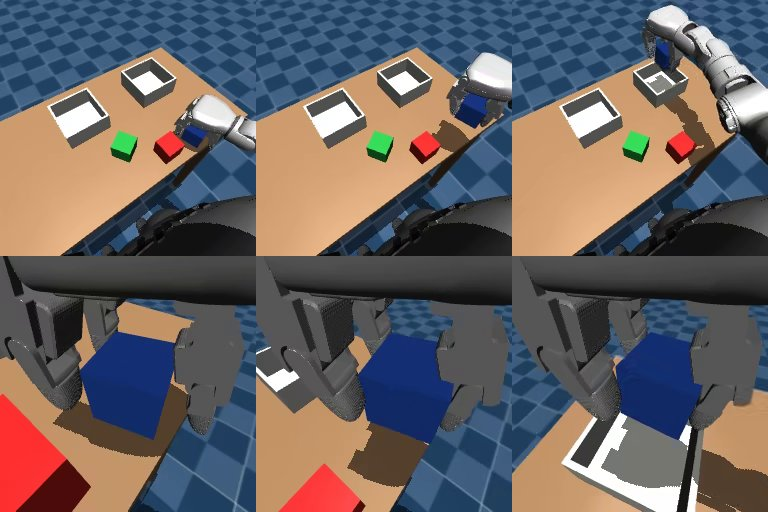

# M2 dataset report

Date: 2026-10-13. Machine: RTX 4070 (12 GB), Ryzen 9 7900X, Ubuntu 26.04 under WSL2.
What every recorded number means is fixed by the [action contract](../ACTION_CONTRACT.md). Each
dataset carries a `manifest.json` (scenarios, expert parameters, checksums, file hashes,
provenance); replay results are in [`results/m2/`](../../results/m2/).

*Frames decoded back from `g1_sort_v1` (train, episode 0): head camera (top) and wrist camera
(bottom) while grasping, lifting and carrying the blue block to the right bin.*

## Verdict

The Milestone 2 exit condition is met. LeRobot loads the dataset with the contract's features,
its videos decode, and replaying every recorded episode's actions from its scenario reproduces
the recorded joint states exactly (worst error 0.0 rad) and the episode's success.

## The datasets

| Split | Layouts | Episodes | Frames | Demonstration time | Rejected | Size | Recording time |
|---|---|---|---|---|---|---|---|
| train | 225 | 300 | 56,364 | 38 min | 5 | 551 MB | 37 min |
| dev | 40 | 55 | 10,367 | 7 min | 2 | 102 MB | 8 min |

- **A frame** is the head and wrist images (256x256), the 14 measured joint angles and the
  instruction at time t, plus the 8-value action executed from t to t + 40 ms.
- **Instructions** are balanced in blocks of six layouts, and about a third of layouts are
  recorded twice with different instructions:

| Instruction (train) | Episodes |
|---|---|
| blue -> left | 51 |
| blue -> right | 52 |
| green -> left | 53 |
| green -> right | 53 |
| red -> left | 47 |
| red -> right | 44 |

  79 training layouts appear with two different instructions.

- **Variation.** Each episode draws the expert's heights, speeds and pauses from modest ranges
  (D-021); episode lengths vary accordingly:

  - Episode length: median 7.5 s, range 6.1-9.5 s
  - Move speed 0.20-0.30 m/s; approach height 8.00-11.99 cm; carry height 14.01-17.96 cm; release height 9.51-10.99 cm

- **Rejected attempts** are kept in `rejected/` with their states and actions, not in the
  dataset:

  - train: `train-100029-blue-left`, dropped
  - train: `train-100075-green-left`, dropped
  - train: `train-100122-blue-left`, dropped
  - train: `train-100126-red-right`, timeout
  - train: `train-100149-red-left`, timeout
  - dev: `dev-200006-red-left`, timeout
  - dev: `dev-200028-red-left`, timeout

  Six of the seven had the target block within 2 cm of the region's left edge (y >= -0.13 m),
  the failure mode found in M1: carrying from there presses the elbow against the torso. The
  seventh knocked a block off the table during the approach. At 1.9% of attempts, rejections
  run above the fixed expert's 0.2% because the randomized parameters add variation.

The pilot dataset (`g1_sort_pilot`, the first 40 training layouts) ran the whole data path
first: 55 episodes (10,370 frames) from 40 layouts, 1 rejected, and all 55 replayed exactly.

## Checks

| Check | How | Result |
|---|---|---|
| Loads with the contract's features | `scripts/replay_dataset.py` compares LeRobot's metadata with `dataset_features` | pass |
| Videos decode | First frame of each camera decoded with PyAV | 256x256, both cameras |
| Data unchanged since recording | SHA-256 of each episode's states and actions against the manifest | 355/355 episodes match |
| Observation-action alignment and action meaning | Replay each episode's actions from its scenario and compare every joint state | 355/355 episodes reproduce their states (worst 0.0 rad) and success |
| Action chunks for SmolVLA | `tests/test_data.py`: 50-action chunks match the recording; padding starts at the episode's end | pass |

## What came up

1. **Replays drifted until actions were float32 end to end.** Datasets store float32 actions,
   but the simulator executed float64 ones. On replay, contact dynamics amplified the rounding:
   2 of 11 test episodes drifted, one by 0.84 rad in a finger joint, although both still
   succeeded. The environment now rounds executed targets to float32 (D-019), and replays match
   bit for bit.
2. **Rendering is the cost of data.** Physics and the expert take 0.2 s per episode; rendering
   two cameras takes about 17 s. Under WSL2 the shadow pass costs a fixed ~17 ms per image, but
   shadows show the hand's height above the table, so they stay. Four worker processes bring
   recording to 7.5 s per episode (D-020).
3. **The wrist camera has to sit beside the hand.** With the palm facing down, a camera on the
   back of the hand sees only the palm, and one behind it mostly sees the thumb (D-017).
4. **Tooling.** LeRobot's dataset support needs its `dataset` extra, and its preferred video
   decoder (torchcodec) needs system FFmpeg libraries, so decoding uses PyAV (D-018).
5. **Provenance caught an edit mid-run.** The pilot's first replay check ran while a test file
   was being edited and was marked dirty; it was re-run from a clean commit.

## Limitations

- Demonstrations are scripted: clean, always successful, and free of the hesitations and
  corrections of human teleoperation. They contain no recoveries from mistakes; Milestone 5
  adds those deliberately.
- One task family on one fixed-base robot; the layout region and bins are fixed (M1).
- PyAV decoding may limit training throughput; Milestone 3 measures it.
- The datasets are local. Publishing them on the Hugging Face Hub is part of the release (M6).

## Next: Milestone 3

Fine-tune SmolVLA on `g1_sort_v1` and run it in closed loop on held-out development layouts.
